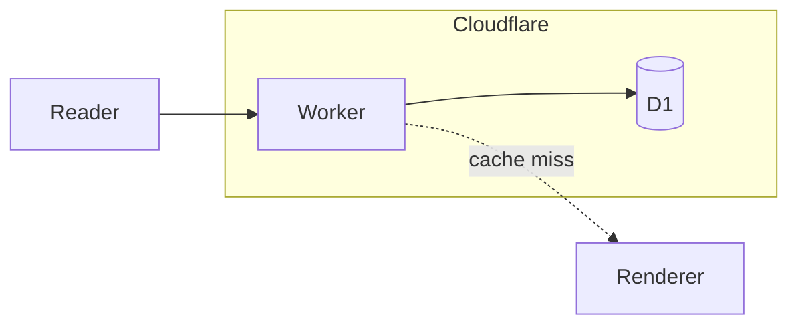
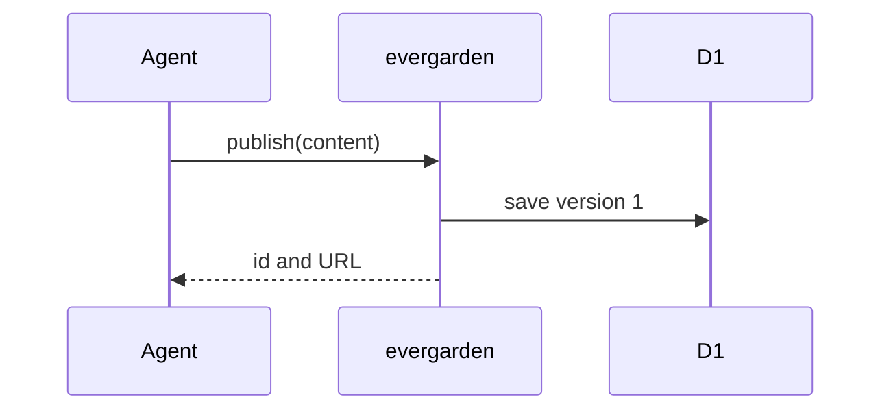
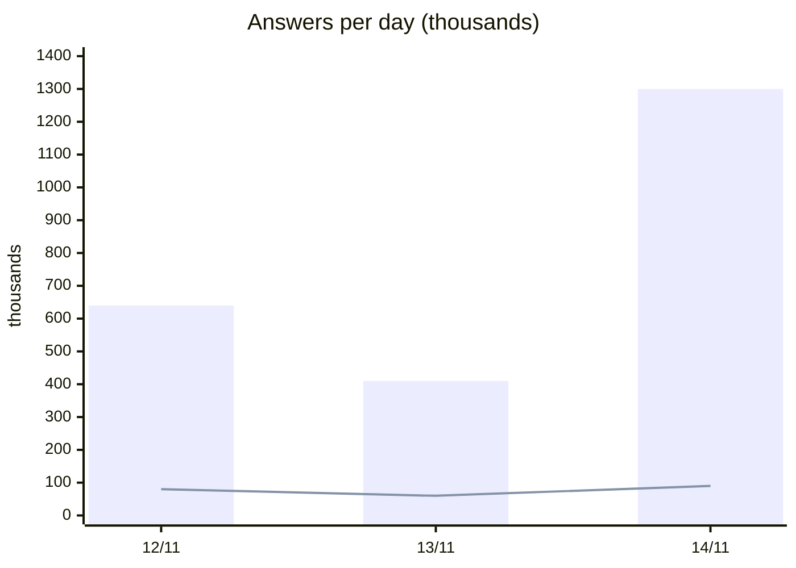
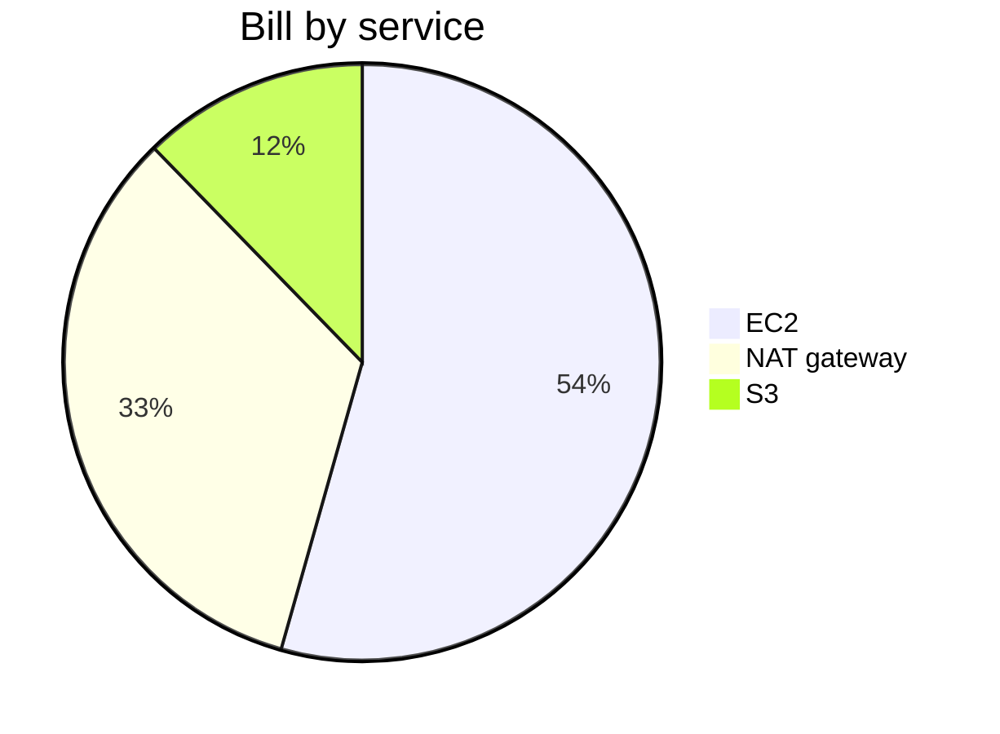

# Diagrams

[Pele](https://pele.run) draws every ` ```mermaid ` block. Diagrams redraw for narrow screens, so prefer them to ASCII drawings. They take their colours from the page in light and dark, so do not set a theme or colours.

| Diagram                                                                                                                    | Good for                                           |
| -------------------------------------------------------------------------------------------------------------------------- | -------------------------------------------------- |
| `flowchart`                                                                                                                | Processes and request paths; `subgraph` groups     |
| `sequenceDiagram`                                                                                                          | Who calls whom, in order                           |
| `stateDiagram-v2`                                                                                                          | States and transitions                             |
| `classDiagram`, `erDiagram`                                                                                                | Types and tables                                   |
| `gantt`, `timeline`                                                                                                        | Schedules and history                              |
| `xychart`                                                                                                                  | Bars and lines over a shared axis                  |
| `pie`, `treemap-beta`                                                                                                      | Parts of a whole                                   |
| `sankey`                                                                                                                   | Flows between stages, such as a budget or a funnel |
| `quadrantChart`                                                                                                            | Items placed on two axes                           |
| `radar-beta`                                                                                                               | Several options scored on the same criteria        |
| `venn-beta`                                                                                                                | Overlapping sets                                   |
| `mindmap`, `treeView-beta`                                                                                                 | Hierarchies, and file trees with notes             |
| `architecture-beta`, `C4Context`                                                                                           | Systems and their parts                            |
| `kanban`, `journey`, `gitGraph`, `packet`, `block`, `requirementDiagram`, `swimlane-beta`, `wardley-beta`, `ishikawa-beta` | What their names say                               |

Examples of every diagram are at https://pele.run/examples.md. The four used most:

````







````

- Name every series in an `xychart` and every curve in a `radar-beta`: `bar "hedy" [...]` and `line "Bright Data" [...]`. The chart draws a legend with their colours, so the title need not say which is the bar and which the line. `pie` names its slices the same way.
- Quote labels that hold anything but letters and digits: `x-axis ["14/10", "15/10"]`. A `pie` title takes no quotes.
- Settings go in frontmatter at the top of the block. Values on the bars, for instance:

  ```
  ---
  config:
    xyChart:
      showDataLabel: true
  ---
  xychart
    ...
  ```

- A `;` ends a Mermaid statement, so a message or label that needs a pause takes a comma: "version 2, with your comment" draws, and "version 2; your comment" fails to parse.
